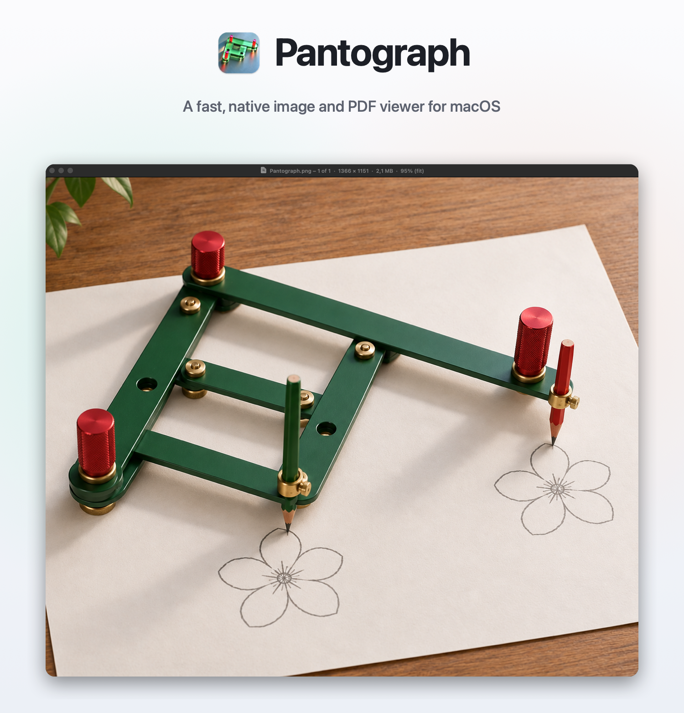

<p align="center">
  
</p>

<h3 align="center">Click through a folder of photos. Scroll to zoom. Sign and edit PDFs.</h3>

<p align="center">
  A lightweight image viewer for the Mac, written in Swift.<br>
  Opens almost anything, plays GIFs and video clips on a loop, and pages through, marks up and signs PDFs.
</p>

<p align="center">
  <a href="https://github.com/JimmysDev/Pantograph/releases/latest"></a><br>
  <sub><b>Free</b> · macOS 13 or later · Apple silicon and Intel · signed and notarized</sub>
</p>

<br>

## What you get

If you've used FastStone Image Viewer on Windows, Pantograph will feel familiar.

**Click to move on.** Click the right half of the image for the next photo in the folder, the left half for the previous one (videos and PDFs in the same folder are skipped; open one of those to step through them with the arrow keys instead, and click a video to pause or play it), and the new picture glides in from that side so you can see what happened. Drag the image to move the window (when you’re zoomed in, dragging moves around the picture instead). The next photos are decoded ahead of time, so they appear instantly.

**Zoom where you're looking.** The scroll wheel or a pinch zooms around the cursor; drag to pan. When you stop, the picture is redrawn sharply with a Lanczos filter. Settings also has a sharp-pixels mode for pixel art and screenshots.

**Keeps itself up to date.** Pantograph checks for new versions about once a day, downloads them in the background and installs them when you quit, with no prompts (you can turn that off in Settings › Updates). There’s also Check for Updates… in the Pantograph menu.

**Picks up where you left off.** Pantograph reopens the file, PDF page and window you had when it last quit.

**Quick fixes.** Right-click a photo, or use the Image menu or a single key, to rotate, flip, crop (with a slider to straighten a tilted horizon while the crop stays level), resize, auto-enhance, and an Adjust panel with live preview for brightness, contrast, gamma, shadows, highlights, saturation, hue and warmth. Everything has undo, and Save keeps the original format and metadata. **Convert to JPEG** (⇧⌘J, or right-click) saves a JPEG copy of a HEIC or any other photo beside the original, at the same visual quality, keeping its date, location and colour.

**Get Info** (⌘I) shows a photo's camera and exposure and lets you edit its title, caption, keywords, creator, copyright and date taken, or remove its location, without re-encoding the picture. For PDFs it edits the title, author, subject and keywords. For any file it shows and edits Finder's Where From, the address it was downloaded from.

**Opens almost anything.** JPEG, PNG, HEIC, AVIF, WebP, JPEG XL, TIFF, PSD, OpenEXR and camera RAW. Animated GIF, APNG and WebP loop. MP4, MOV and WebM clips loop, starting muted. PDFs scroll through all their pages, with a scroll bar, and re-render sharply as you zoom.

**Sign PDFs.** Draw your signature with the mouse or trackpad, or import a picture of it, and Pantograph keeps it for next time. Drag it into place, resize it from a corner, and save. Any PDF app shows it.

**Mark up PDFs.** Type text boxes in any font on your Mac, highlight, underline or strike through text, draw freehand, and add boxes, ovals, arrows and lines, from the toolbar above every PDF or with a single key. Right-click a page to add a signature, text or a shape right where you clicked. Drag to move, pull a handle to resize, double-click to retype. Letter spacing steps by 0.1 pt, for lining text up with the boxes on a form. Everything is saved as standard PDF annotations with their look and fonts embedded, so other PDF apps show it where you put it, rotated pages included, and Pantograph can edit it again later.

**Split and make PDFs.** Export the page you're on, or any list like "3, 5–7", as a new PDF. Pick a few photos or scans and combine them into one PDF, a page each, in the order you choose.

**Works with scripts and AI agents.** The `pantograph` command (Settings › Command line and AI agents installs it) watermarks, converts, resizes, rotates, crops and straightens, adjusts, and applies effects to images, edits their information and Where From, and extracts, merges, makes and renders PDFs, without opening a window. It fills in PDF forms too: real form fields by name, or flat and scanned forms by finding a label (read with text recognition on scans) and writing beside it, or finding a row of letter boxes and putting one character in each, with the same editable text boxes as the app. Then it zooms in to check, lists and removes mistakes, and flattens the result, still searchable, before it's sent. Watermarks can be text or a logo, in a corner, centred or tiled across the page; on PDFs they're drawn into the page, so they print, and the document's text, links and bookmarks stay as they were. Results go beside the original under a new name, and nothing is replaced unless you ask. `pantograph mcp` offers the same tools to AI agents over the Model Context Protocol; Settings copies the one-line setup for Claude Code, and **Add to Claude Desktop** installs them in the Claude app as an extension (each release also has `Pantograph.mcpb` to double-click). `pantograph help` lists everything.

```
pantograph watermark *.jpg --text "© My Studio" --position bottom-right --opacity 0.4
pantograph watermark contract.pdf --image logo.png --position tile --opacity 0.15
pantograph convert IMG_0412.HEIC --to jpeg
pantograph fill-form application.pdf --values '{"full_name":"Jo Bloggs","agree":true}'
pantograph add-text lease.pdf --text "Jo Bloggs" --page 2 --x 140 --y 312 --anchor baseline
```

<br>

## Keyboard

| Key | Does |
|:--|:--|
| → / ← · Space / Backspace | Next / previous file or PDF page |
| Scroll · + / − · 0 · 1 | Zoom (in a PDF: scroll; pinch or ⌘-scroll zooms) · zoom in / out · fit · 100% |
| L / R · H / V | Rotate left / right · flip |
| X · Return · Esc | Crop · apply · cancel |
| S | Sign a PDF |
| E · T · D | In a PDF: select · text box · draw |
| H · U · ⇧U | In a PDF: highlight · underline · strike through |
| B · O · A · ⇧A | In a PDF: box · oval · arrow · line |
| ⌥⌘E · ⌥⌘I | Export pages of a PDF · make a PDF from images |
| ⌘P | Print, with any markup and signatures |
| A · E | Adjust colours · auto-enhance |
| P · M · , / . | Play / pause · sound · step a frame |
| F · Delete | Full screen · move to Trash |

Help → Keyboard Shortcuts in the app has the full list.

<br>

## Coming later

- RAW development: white balance, exposure and highlight recovery working on the original sensor data
- A thumbnail gallery for browsing a folder

<br>

<sub>Pantograph is free to download and use. © 2026 JimmysDev. All rights reserved. Mac and macOS are trademarks of Apple Inc.</sub>
